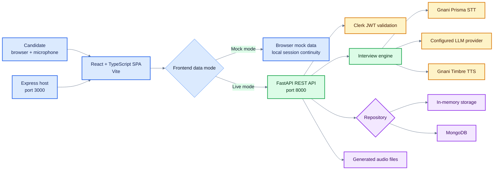
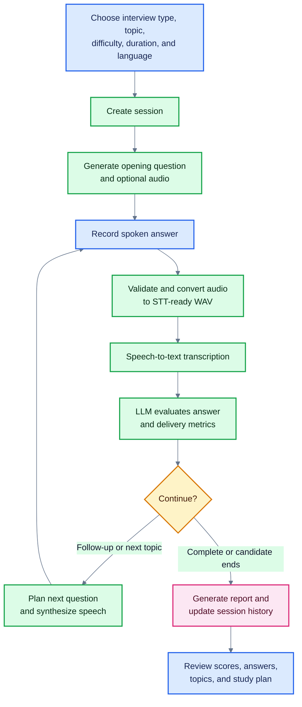
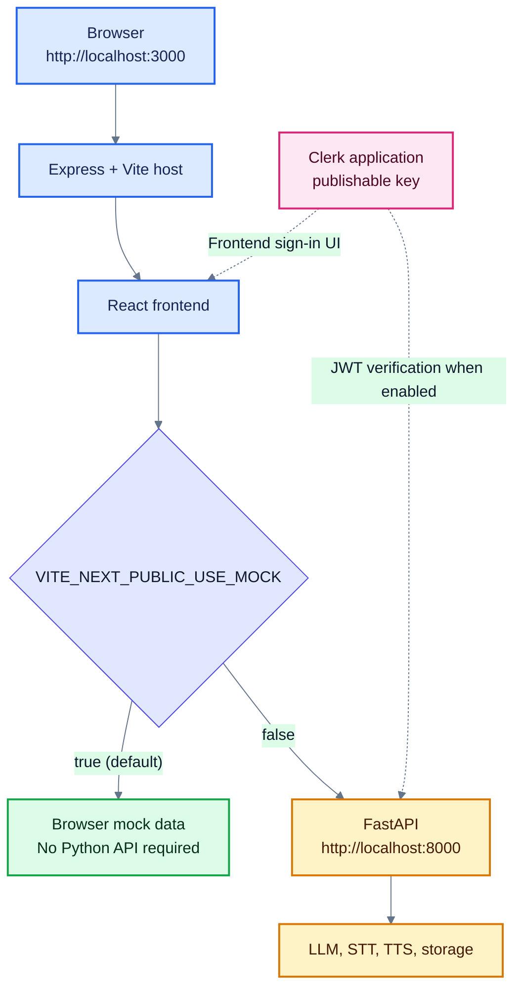

# InterviewIQ AI

InterviewIQ AI is a voice-first interview practice application. Candidates can run technical, behavioral, mixed, and coding mock interviews, receive adaptive follow-up questions, review rubric-based feedback, and track their practice history.

The repository contains a React/TypeScript frontend and a Python/FastAPI service. You can run the frontend in **mock mode** for a quick UI walkthrough, or connect it to the backend for live authentication, speech processing, interview evaluation, and persistence.

## Contents

- [Highlights](#highlights)
- [Application architecture](#application-architecture)
- [Interview turn lifecycle](#interview-turn-lifecycle)
- [Coding practice workflow](#coding-practice-workflow)
- [Technology](#technology)
- [Requirements](#requirements)
- [Quick start: mock mode](#quick-start-mock-mode)
- [Run the live application](#run-the-live-application)
- [Environment configuration](#environment-configuration)
- [HTTP API overview](#http-api-overview)
- [Project layout](#project-layout)
- [Development commands](#development-commands)
- [Storage, privacy, and safety](#storage-privacy-and-safety)
- [Troubleshooting](#troubleshooting)

## Highlights

- **Adaptive interviews:** technical, HR/behavioral, mixed, and coding practice with follow-up questions selected from the candidate's responses.
- **Spoken answers:** upload recorded answers for transcription and evaluation. The backend converts supported browser recordings to normalized audio before sending them to speech recognition.
- **Multilingual sessions:** English, Tamil, and Hindi interview language options.
- **Structured feedback:** each answer is assessed for technical correctness (35%), conceptual understanding (25%), completeness (20%), relevance (10%), and communication clarity (10%).
- **Performance reports:** review answer transcripts, score breakdowns, topic results, strengths, weaknesses, and a study plan.
- **Coding rounds:** discuss an approach aloud, then submit Python, JavaScript, or Java source for static AI review.
- **Practice tracking:** view session history, dashboard statistics, badges, and a configurable weekly goal.
- **Resume-based setup:** upload a PDF or DOCX resume to extract a profile used to personalize interview questions.
- **Theme-aware responsive interface:** includes a dashboard, interview setup, live session room, reports, history, and achievements.

## Application architecture

The frontend supports two data paths. Mock mode uses data and behavior implemented in the browser and does not require the Python API. Live mode sends API requests to FastAPI. The Express server provides the development host and production static-file host for the frontend.



### Interview turn lifecycle



### Coding practice workflow

Candidate code is reviewed as text. The backend does **not** run, compile, or evaluate submitted code in an execution environment.

```mermaid
%%{init: {'theme':'base','themeVariables':{'primaryColor':'#ede9fe','primaryTextColor':'#0f172a','primaryBorderColor':'#7c3aed','lineColor':'#64748b','secondaryColor':'#cffafe','tertiaryColor':'#ffedd5'}}}%%
flowchart LR
    Create["Start a coding session"] --> Problem["Receive problem,<br/>examples, and starter code"]
    Problem --> Explain["Explain algorithm<br/>and trade-offs aloud"]
    Explain --> Feedback["Transcribe and assess<br/>the approach"]
    Feedback --> Editor["Write or edit solution<br/>in the browser"]
    Editor --> Submit["Submit source as text"]
    Submit --> Review["LLM performs static review"]
    Review --> Result["Review feedback and scores<br/>in the session report"]

    classDef candidate fill:#cffafe,stroke:#0891b2,color:#164e63,stroke-width:2px
    classDef service fill:#ede9fe,stroke:#7c3aed,color:#2e1065,stroke-width:2px
    classDef output fill:#ffedd5,stroke:#ea580c,color:#431407,stroke-width:2px
    class Create,Problem,Explain,Editor,Submit candidate
    class Feedback,Review service
    class Result output
```



### Local run modes



## Technology

| Area | Technologies |
| --- | --- |
| Web client | React 19, TypeScript, Vite 8, React Router, Tailwind CSS 4 |
| UI and charts | Radix-based UI components, Lucide icons, Motion, Recharts |
| Authentication | Clerk React SDK in the frontend; Clerk RS256/JWKS validation in FastAPI |
| API | Python 3.11+, FastAPI, Pydantic 2, Uvicorn |
| Interview evaluation | Groq, Anthropic, or a configurable OpenAI-compatible chat API |
| Speech | Gnani Vachana STT and Timbre TTS; FFmpeg-based audio normalization |
| Persistence | In-memory repository by default, optional MongoDB |
| Tests | pytest, pytest-asyncio, respx; TypeScript check via `npm run lint` |

## Requirements

### For the frontend

- Node.js and npm versions supported by the installed Vite release (a current Node.js LTS release is recommended).
- A Clerk application and its **publishable key**. The frontend expects this key even when using mock data.

### For the live backend

- Python 3.11 or newer.
- FFmpeg available on `PATH` for audio normalization.
- Credentials for the configured LLM provider.
- A Gnani API key for live transcription and generated speech.
- MongoDB only if `STORAGE_BACKEND=mongo` is selected.

## Quick start: mock mode

Mock mode is the fastest way to explore the interface. It uses browser-side sample data; it does not exercise FastAPI, real transcription, or real LLM evaluation. Clerk still needs a publishable key for the frontend to initialize.

1. Install Node.js and npm.
2. Create a Clerk application and copy its publishable key.
3. From the repository root, create `.env.local`:

   ```dotenv
   VITE_CLERK_PUBLISHABLE_KEY=pk_test_replace_with_your_key
   VITE_NEXT_PUBLIC_USE_MOCK=true
   ```

4. Install dependencies and launch the development host:

   ```powershell
   npm install
   npm run dev
   ```

5. Open [http://localhost:3000](http://localhost:3000).

Mock mode is enabled by default in the frontend code. Set it explicitly as shown above to make the selected mode clear.

## Run the live application

The live configuration uses the browser app, FastAPI, Clerk, an LLM provider, and—if spoken interview answers are required—Gnani speech services.

### 1. Configure and start FastAPI

In PowerShell:

```powershell
cd backend
py -3.11 -m venv venv
.\venv\Scripts\Activate.ps1
python -m pip install -r requirements.txt
Copy-Item .env.example .env
```

Edit `backend/.env` for local development. At minimum, configure:

```dotenv
APP_ENV=dev
AUTH_DISABLED=true
STORAGE_BACKEND=memory
LLM_PROVIDER=groq
GROQ_API_KEY=replace_with_your_groq_key
GNANI_API_KEY=replace_with_your_gnani_key
```

`AUTH_DISABLED=true` is only suitable for a local development environment. The backend will use the shared `dev-user` identity; do not use this setting for a public or production deployment.

Start the API from the `backend` directory:

```powershell
uvicorn app.main:app --reload --host 0.0.0.0 --port 8000
```

The health endpoint is [http://localhost:8000/api/health](http://localhost:8000/api/health), and interactive OpenAPI documentation is available at [http://localhost:8000/docs](http://localhost:8000/docs).

### 2. Configure and start the frontend

In a second terminal at the repository root, create or update `.env.local`:

```dotenv
VITE_CLERK_PUBLISHABLE_KEY=pk_test_replace_with_your_key
VITE_NEXT_PUBLIC_API_BASE_URL=http://localhost:8000
VITE_NEXT_PUBLIC_USE_MOCK=false
```

Then run:

```powershell
npm install
npm run dev
```

Open [http://localhost:3000](http://localhost:3000). Allow microphone access when prompted. A local Clerk token is not needed while the backend has `AUTH_DISABLED=true`. When backend authentication is enabled, configure the Clerk JWKS URL and issuer in the backend and use the same Clerk application in the frontend.

### 3. Optional MongoDB storage

The default repository is in-memory and loses data when the backend process restarts. To use MongoDB, ensure a MongoDB instance is reachable and set:

```dotenv
STORAGE_BACKEND=mongo
MONGODB_URI=mongodb://localhost:27017
MONGODB_DB=interviewiq
```

## Environment configuration

Backend settings are read from `backend/.env` when the server is started from the `backend` directory. The checked-in [`backend/.env.example`](./backend/.env.example) contains development-oriented values; replace blank API keys locally and never commit real credentials.

### Frontend

| Variable | Default | Description |
| --- | --- | --- |
| `VITE_CLERK_PUBLISHABLE_KEY` | — | Clerk publishable key required to initialize the frontend. |
| `VITE_NEXT_PUBLIC_API_BASE_URL` | `http://localhost:8000` | Base URL used for live API requests. |
| `VITE_NEXT_PUBLIC_USE_MOCK` | `true` | Set to `false` to send requests to the configured API. |

### Backend

| Variable | Default | Description |
| --- | --- | --- |
| `APP_ENV` | `dev` | Runtime environment label. |
| `PUBLIC_BASE_URL` | `http://localhost:8000` | Public origin used for generated media URLs. |
| `CORS_ORIGINS` | `http://localhost:3000,http://127.0.0.1:3000` | Comma-separated browser origins allowed by CORS. |
| `AUTH_DISABLED` | `false` in settings; `true` in the example file | Disables JWT checks and assigns requests to `dev-user`. Use only locally. |
| `CLERK_JWKS_URL` | empty | Clerk JWKS endpoint used to verify RS256 tokens. |
| `CLERK_ISSUER` | empty | Optional expected JWT issuer. |
| `CLERK_AUTHORIZED_PARTIES` | empty | Optional comma-separated allowed `azp` values. |
| `STORAGE_BACKEND` | `memory` | Select `memory` or `mongo`. |
| `MONGODB_URI` | `mongodb://localhost:27017` | MongoDB connection string when using MongoDB storage. |
| `MONGODB_DB` | `interviewiq` | MongoDB database name. |
| `DEFAULT_TIMEZONE` | `Asia/Kolkata` | Timezone used for practice-week and streak calculations. |
| `LLM_PROVIDER` | `groq` | Choose `groq`, `anthropic`, or `openai_compat`. |
| `GROQ_API_KEY` | empty | Groq credential; used with the Groq provider. |
| `GROQ_BASE_URL` | `https://api.groq.com/openai/v1` | Groq OpenAI-compatible endpoint. |
| `GROQ_MODEL` | `openai/gpt-oss-20b` | Groq model for interview turns. |
| `GROQ_MODEL_REPORT` | `openai/gpt-oss-20b` | Groq model for report generation. |
| `ANTHROPIC_API_KEY` | empty | Credential for the Anthropic provider. |
| `LLM_MODEL_FAST` | `claude-3-5-haiku-latest` | Anthropic model used for faster interview turns. |
| `LLM_MODEL_REPORT` | `claude-3-5-sonnet-latest` | Anthropic model used for report generation. |
| `OPENAI_COMPAT_BASE_URL` | `https://api.groq.com/openai/v1` | Base URL for the generic OpenAI-compatible provider. |
| `OPENAI_COMPAT_API_KEY` | empty | Credential for the generic OpenAI-compatible provider. |
| `OPENAI_COMPAT_MODEL_FAST` | `openai/gpt-oss-20b` | Generic provider model for interview turns. |
| `OPENAI_COMPAT_MODEL_REPORT` | `openai/gpt-oss-20b` | Generic provider model for reports. |
| `GNANI_API_KEY` | empty | Gnani credential for STT and TTS. |
| `GNANI_STT_URL` | `https://api.vachana.ai/stt/v3` | Speech-to-text endpoint. |
| `GNANI_TTS_URL` | `https://api.vachana.ai/api/v1/tts/inference` | Text-to-speech endpoint. |
| `STT_MODEL` | empty | Optional speech recognition model override. |
| `STT_BIAS_ENABLED` | `true` | Sends expected concepts as transcription key terms when supported. |
| `TTS_MODEL` | `timbre-v2.5` | Speech synthesis model. |
| `TTS_SAMPLE_RATE` | `24000` | Generated audio sample rate. |
| `TTS_SPEED` | `1.0` | Speech synthesis speed. |
| `VOICE_EN` / `VOICE_TA` / `VOICE_HI` | `Kaveri` / `Vedika` / `Nalini` | Configured English, Tamil, and Hindi voices. |
| `MEDIA_DIR` | `./storage/audio` | Directory used for generated audio files. |
| `MEDIA_TTL_HOURS` | `24` | Retention period for generated audio before cleanup. |
| `MAX_UPLOAD_MB` | `10` | Maximum accepted interview audio upload size. |
| `CODING_RATE_LIMIT_PER_HOUR` | `20` | Per-user hourly limit for coding approach and code review requests. |
| `DEEP_HEALTH` | `false` | Reserved configuration flag; deep diagnostics are exposed at `/api/health/deep`. |

## HTTP API overview

The FastAPI API is rooted at `/api`. JSON request and response fields use camelCase. Authenticated endpoints require `Authorization: Bearer <Clerk JWT>` unless `AUTH_DISABLED=true`.

| Method | Path | Purpose |
| --- | --- | --- |
| `GET` | `/api/health` | Basic service health; no authentication required. |
| `GET` | `/api/health/deep` | Checks FFmpeg, writable media storage, and configured database; authentication required. |
| `POST` | `/api/sessions` | Create a technical, HR, mixed, or coding session. |
| `GET` | `/api/sessions` | List the current user's sessions. |
| `POST` | `/api/sessions/{id}/answer` | Submit a recorded answer as multipart form data (`questionId` and `audio`). |
| `GET` | `/api/sessions/{id}/coding/problem` | Fetch the coding prompt associated with a coding session. |
| `POST` | `/api/sessions/{id}/coding/approach` | Submit a recorded explanation of the coding approach. |
| `POST` | `/api/sessions/{id}/coding/submit` | Submit source text for static code review. |
| `POST` | `/api/sessions/{id}/end` | End a session and award any eligible badges. |
| `GET` | `/api/sessions/{id}/report` | Retrieve the completed session report. |
| `GET` | `/api/stats` | Read dashboard analytics. |
| `GET`, `POST`, `DELETE` | `/api/resume/profile` | Read, upload, or delete an extracted resume profile. Upload accepts PDF or DOCX up to 5 MB. |
| `GET` | `/api/badges` | Read badge definitions and user progress. |
| `GET`, `PUT` | `/api/goals/weekly` | Read or update the weekly interview goal; target range is 1–14. |

For exact request schemas and response examples, use the running service's Swagger UI at `/docs`.

## Project layout

```text
.
├── backend/
│   ├── app/
│   │   ├── auth/          # Clerk token verification
│   │   ├── db/            # Repository protocol and memory/Mongo implementations
│   │   ├── routers/       # Health, sessions, reports, resume, stats, goals, badges
│   │   ├── services/      # Audio, STT/TTS, interview engine, scoring, reports
│   │   ├── config.py      # Pydantic settings
│   │   └── main.py        # FastAPI app and middleware
│   ├── scripts/           # Local engine, speech, and end-to-end helpers
│   ├── tests/             # Backend pytest suite
│   ├── .env.example
│   └── requirements.txt
├── src/
│   ├── components/        # UI, interview room, setup, dashboard, reports
│   ├── hooks/             # Audio recorder and player
│   ├── lib/               # API client, types, auth, mock data, utilities
│   ├── pages/             # Application routes
│   ├── App.tsx
│   └── main.tsx
├── public/                # Static assets
├── server.ts              # Express + Vite development host / production host
├── package.json
└── README.md
```

## Development commands

Run frontend commands from the repository root:

| Command | Description |
| --- | --- |
| `npm run dev` | Start Express with Vite middleware for local development. |
| `npm run lint` | Run the TypeScript compiler without emitting files. |
| `npm run build` | Build frontend assets and bundle the Express server. |
| `npm run preview` | Start Vite's static preview server for the built frontend. |
| `npm start` | Start the generated production Express server after `npm run build`. |

Run backend commands from `backend/` with the virtual environment active:

| Command | Description |
| --- | --- |
| `pytest` | Run the backend test suite. |
| `python scripts/try_engine.py` | Run the terminal interview-engine simulator. |
| `python scripts/smoke_gnani.py` | Check Gnani service connectivity. |
| `python scripts/e2e.py` | Run the voice-loop end-to-end helper. |

Some helper scripts require valid provider credentials and access to their external services.

## Storage, privacy, and safety

- The default in-memory repository is intended for local development and does not persist data across backend restarts. Use MongoDB when durable storage is needed.
- Resume uploads are parsed into a concise profile; the original uploaded file is not retained by the resume service. The extracted profile follows the selected repository's persistence behavior.
- Generated audio is stored under `MEDIA_DIR` and expired files are cleaned up based on `MEDIA_TTL_HOURS`.
- Use `AUTH_DISABLED=true` only on a trusted local development machine. Production deployments should configure Clerk verification and a restricted `CORS_ORIGINS` list.
- Submitted coding solutions are reviewed as text and are not executed, compiled, or evaluated by the backend.
- Keep `.env`, `.env.local`, API keys, and database credentials out of source control. The repository's `.gitignore` excludes local `.env*` files other than explicitly named examples.

## Troubleshooting

### Frontend says Clerk is not configured

Set `VITE_CLERK_PUBLISHABLE_KEY` in the root `.env.local` file, then restart `npm run dev`.

### The frontend is still using sample data

Set `VITE_NEXT_PUBLIC_USE_MOCK=false` and `VITE_NEXT_PUBLIC_API_BASE_URL=http://localhost:8000` in `.env.local`. Restart Vite after changing environment variables.

### Browser requests fail with a CORS error

Make sure the exact frontend origin is listed in the backend `CORS_ORIGINS`, for example `http://localhost:3000`. If you use `127.0.0.1`, add that origin too.

### Audio conversion or transcription fails

Confirm FFmpeg is installed and discoverable from the backend process, and check that `GNANI_API_KEY` is configured. The backend rejects empty recordings and uploads larger than `MAX_UPLOAD_MB`.

### Protected API requests return 401

For local-only testing, confirm `AUTH_DISABLED=true` in the backend `.env`. For Clerk authentication, configure `CLERK_JWKS_URL`, and—if applicable—`CLERK_ISSUER` and `CLERK_AUTHORIZED_PARTIES`, then ensure the frontend is signed in to the matching Clerk application.

### MongoDB health check fails

Verify MongoDB is running, `MONGODB_URI` is reachable from the backend, and `STORAGE_BACKEND=mongo` is set only when using MongoDB.

### Provider errors or rate limits

Check that the chosen `LLM_PROVIDER` has its corresponding credentials and model names configured. Speech provider limits can also affect transcription and synthesis; review backend logs for the request ID and provider error.
